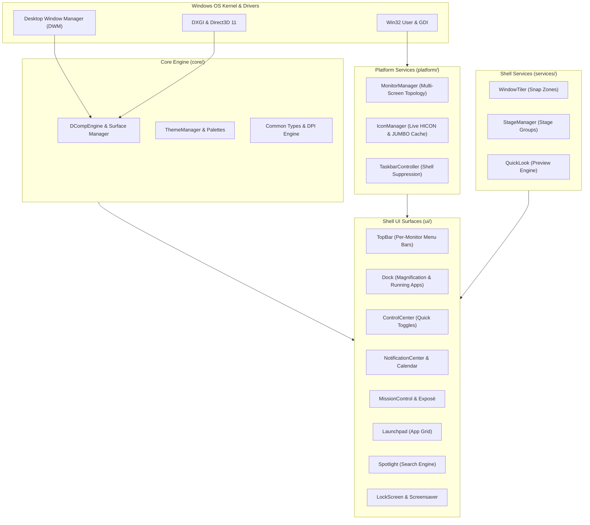

# AquaShell Architecture & Technical Specification

## 1. System Overview

AquaShell is an enterprise-grade desktop environment layer for Windows written in modern C++20. It replaces the traditional Windows Explorer desktop shell experience with a high-performance macOS-style UI ecosystem built upon pure Win32, DirectComposition, and Direct2D.

---

## 2. Subsystem Organization

The codebase is organized into modular subsystems:

### `core/` (Graphics & Base Services)
* **`DCompRenderer`**: Hardware-accelerated DirectComposition engine. Manages `ID3D11Device`, `ID2D1DeviceContext`, per-window composition visual trees, and transparent swap surfaces with zero per-frame allocation.
* **`ThemeManager`**: Manages persistent brush palettes, frosted glass materials, dynamic light/dark mode transitions, and system accent colors.
* **`Common.h`**: Root definitions, Windows SDK configuration, DPI scaling helpers, KaTeX mathematical math/render constants, and smart pointer aliases.

### `platform/` (Windows OS Interoperability)
* **`SystemInfo`**: Houses `MonitorManager` for virtual desktop bounds, per-monitor resolution enumeration, work-area management, and system hardware queries (battery, memory, CPU load).
* **`IconManager`**: High-performance icon resolution pipeline. Interrogates live windows via `WM_GETICON` and `GCLP_HICON`, retrieves 256×256 `SHIL_JUMBO` icons from executables, and synthesizes 32-bit premultiplied alpha bitmaps.
* **`TaskbarController`**: Safely suppresses the native Windows taskbar (`Shell_TrayWnd` and `Shell_SecondaryTrayWnd`) and restores screen work areas on startup and shutdown.

### `ui/` (macOS Shell Surfaces)
* **`Dock`**: macOS-style physics-driven magnification Dock. Supports pinned applications, dynamic running applications, running status dots, bounce physics, and context menus.
* **`TopBar`**: Instantiated independently for each physical monitor. Displays Apple menu, application menus, status widgets (Wi-Fi, Battery, Clock), and Control Center anchor.
* **`ControlCenter`**: Interactive control panel with frosted glass toggles for volume, display brightness, Bluetooth, Wi-Fi, and media playback.
* **`NotificationCenter`**: Side-panel flyout featuring calendar, system notifications, and widgets.
* **`MissionControl`**: Spans the entire virtual desktop to present an Exposé view of all open windows and virtual desktops.
* **`Launchpad`**: Fullscreen app launcher featuring searchable, paginated grid of installed desktop applications.
* **`Spotlight`**: Global keyboard-summoned search bar (`Cmd/Win + Space`) for application launching and quick calculations.
* **`LockScreen`**: Multi-display screensaver and lock screen with authentic macOS clock and user login presentation.

### `services/` (Window Management Services)
* **`WindowTiler`**: macOS Sequoia-style snap tiling engine with snap zone previews and keyboard shortcuts.
* **`StageManager`**: Visual stage management grouping active app windows into thumbnail side-strips.
* **`QuickLook`**: Spacebar-activated instant preview for files, documents, and media.

---

## 3. Performance & Stability Principles
1. **Zero-Allocation Rendering**: Direct2D brushes and DirectWrite text formats are created once and reused. No GDI or COM allocations are executed inside 60-120Hz render loops.
2. **Crash Resilience**: Background threads and IPC hooks are isolated. Exceptions or missing window handles gracefully fall back to default assets without crashing the shell.
3. **Taskbar Preservation**: Dedicated fallback mechanisms (`RestoreTaskbar.exe` / `restore.bat`) guarantee Windows taskbar visibility can always be restored.
